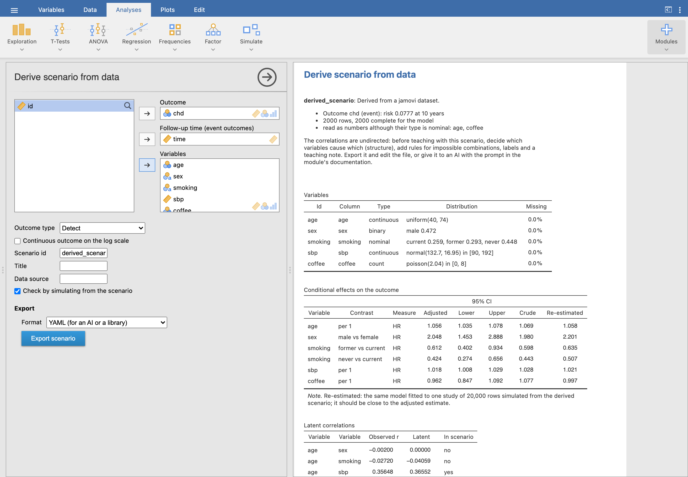
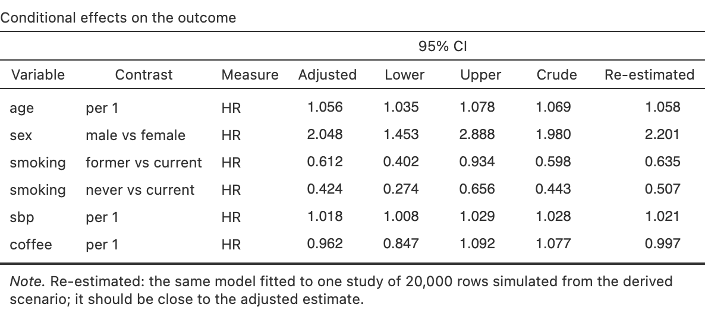

*Simulate ▸ Derive scenario* turns a real dataset into a scenario that simulates
studies like it: the plasmode idea, without sharing the data.

{.screenshot}

## What it estimates

- the **marginal** distribution of each variable (normal, log-normal, gamma or
  uniform; Poisson or negative binomial for counts; category proportions);
- the **latent correlations**, by inverting the Gaussian copula the simulator
  uses, so a simulated study reproduces the observed correlations;
- the **conditional effects** on the outcome (logistic, linear, Poisson or Cox,
  with 95% CI and the crude estimate), and the prevalence, mean, risk or Weibull
  shape that calibrates it.

*Check by simulating* analyses one large study simulated from the derived scenario
with the same model: the **Re-estimated** column should match the adjusted
estimates.

{.screenshot width=85%}

Columns that jamovi read as nominal but hold numbers (integers from a CSV) are
read as numbers. Try it with
[chd_sim.csv](screenshots/chd_sim.csv), a simulated cohort.

## Finishing it with an AI

The data cannot tell causes from correlates, so a derived scenario has undirected
correlations and raw column names. *Export scenario* writes it as YAML with a
`derivation:` block (source, original names, missing data, estimates and
correlations), which is what an AI needs to finish it:

- [**A prompt for any AI**](https://github.com/victor-moreno/jamovi-studysim/blob/main/ai/prompt-derive-to-scenario.md):
  attach the exported YAML and `schema.md`. It returns the scenario with names and
  translations, a causal structure, rules for impossible combinations, rounded
  effects, a teaching note and references marked *to verify*, plus a report of
  its decisions.
- [**A Claude skill**](https://github.com/victor-moreno/jamovi-studysim/tree/main/ai/studysim-scenario)
  (also as a zip in the Releases): the same steps, with a validator,
  `check_scenario.R`, that checks the file, simulates a large study and compares
  the re-estimated effects with the data's, following renamed variables and
  changed reference categories.

Review the result before teaching with it: the causal structure is a judgement,
and references must be checked.
