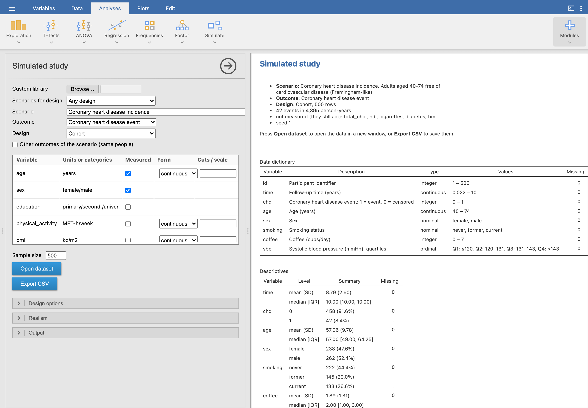

**studysim** is a [jamovi](https://www.jamovi.org) module that simulates plausible
datasets of medical studies. A student picks a **clinical scenario**, one of its
**outcomes**, a **study design** that fits it, a sample size and some realism, and
gets a dataset in a new jamovi window. A hidden **answer key** gives the true
parameters and what crude and adjusted analyses of that design should find.

{.screenshot}

## Why simulated studies

Real teaching datasets are few, and they never come with the truth. A simulated
study does: confounders, mediators, effect modifiers and null variables are built
in, so students can check whether their analysis recovers the effects, see why the
crude estimate differs from the adjusted one, and what a design or a missing
variable does to the answer. Every student can get a different dataset from the
same assignment (a *student key*), and the teacher can regenerate any of them.

## The menu

| Analysis | What it does |
|---|---|
| [Simulated study](simulated-study.qmd) | scenario → outcome → design → dataset, data dictionary, descriptives, causal diagram, answer key |
| [Compare designs](simulated-study.qmd) | one scenario under several designs from the same population: estimates with 95% CI against the truth |
| [Library](library.qmd) | lists, checks, explores and exports the scenarios; reads custom libraries (YAML, Excel, JSON) |
| [Derive scenario](derive.qmd) | estimates a scenario from a real dataset, to simulate studies like it |

[Teaching with studysim](teaching.qmd) has worked exercises, and
[How it works](how-it-works.qmd) describes the simulation model.

## Install

Download the `.jmo` for your computer from the
[Releases](https://github.com/victor-moreno/jamovi-studysim/releases) page
(`x64` for Intel/AMD, `arm64` for Apple silicon) and in jamovi go to
**Modules (⊕) → Sideload**. It needs jamovi 28.4 or newer and no other
package. The interface and the built-in scenarios are in English, Spanish and
Catalan; jamovi's language setting chooses.

## The scenarios

The module ships with 50 scenarios across 19 clinical domains (dentistry and podiatry among them), most of them
replicating a real study from its open data or its published tables, with
several scenarios for every design. The [scenario catalogue](scenarios.qmd)
explains how they were made and lets you filter them by domain, design, outcome
and teaching topic.
