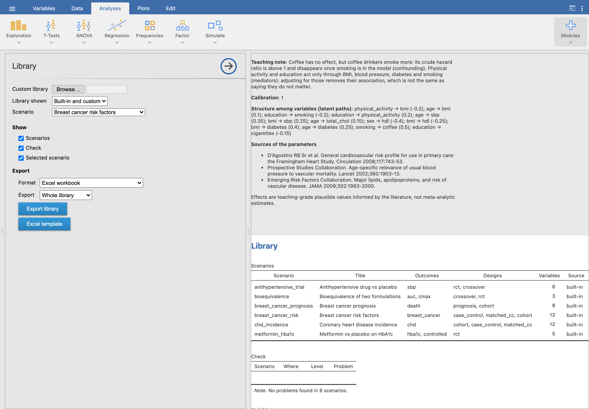

A library is a dictionary of shared variables plus **scenarios**, one clinical
question each. The built-in one is in the module (`inst/library/`); teachers can
write their own in **YAML** or **Excel**. The full format is in
[schema.md](https://github.com/victor-moreno/jamovi-studysim/blob/main/inst/library/schema.md).

## The Library analysis

{.screenshot}

- *Browse…* reads a custom library (`.yaml`, `.xlsx`, `.json` or a `.zip` of them);
  *Library shown* chooses built-in, custom or both.
- *Scenarios for design* lists only the scenarios with an outcome that fits a
  design.
- *Check* lists problems in plain language, located by scenario and field.
- *Export library* writes the library or one scenario as Excel, JSON or zipped
  YAML; *Excel template* gives a workbook with a worked example and the format.
- The *Simulated study* pickers read custom libraries in **JSON**; export a YAML or
  Excel library as JSON here to use it there.

## A scenario in brief

```yaml
id: breast_cancer_risk
label: {en: Breast cancer risk factors, es: Factores de riesgo de cáncer de mama}
variables:
  age: {from: dictionary, dist: "uniform(35, 75)"}
  menarche: {type: continuous, dist: normal(12.6, 1.4), range: [9, 17], round: 0}
  menopause:
    type: binary
    levels: [pre, post]
    p: plogis((age - 51) / 1.5)          # rule: menopause depends on age
  hrt:
    type: binary
    p: 0.25
    levels: [never, ever]
    only_if: menopause == "post"         # structural value
    otherwise: never
structure:                                 # latent paths among variables
  - [age, parity, 0.25]
outcomes:
  breast_cancer:
    type: event
    rate: 2.5/1000
    designs: [case_control, matched_cc, cohort]
    effects:
      age: {HR: 1.04, per: 1}
      bmi: {HR: 1.12, per: 5, by: {menopause: {pre: 0.93, post: 1.12}}}
null_variables: [education, coffee]
teaching: {en: "Age confounds parity and menopause...", es: "..."}
```

- **Variables**: continuous (normal, log-normal, gamma, beta, uniform), counts
  (Poisson, negative binomial), binary, nominal, ordinal and genotypes.
- **Structure and correlations** among variables, and **rules**: a probability
  that depends on other variables, structural values (`only_if`/`otherwise`) and
  formulas for derived variables.
- **Outcomes**: binary (prevalence), events (rate, risk or median; Weibull shape),
  continuous (also on the log scale) and counts, each with conditional effects
  (OR, HR, RR, ratio, beta), effect modification (`by:`) and interventions for
  trials.
- **Translations**: labels in several languages, and an `i18n:` section with the
  column names and category labels students see.
