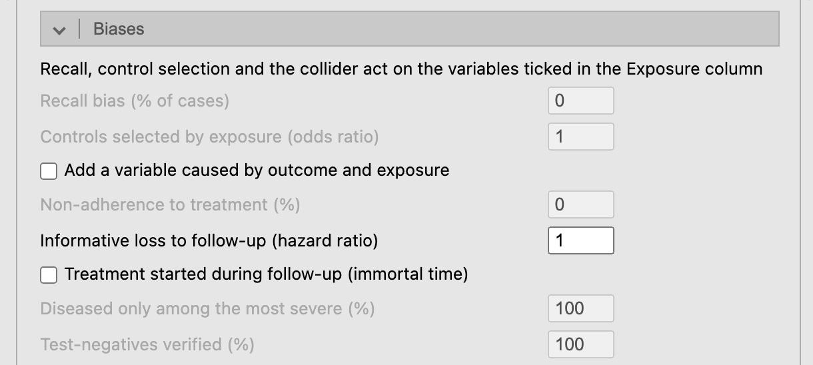
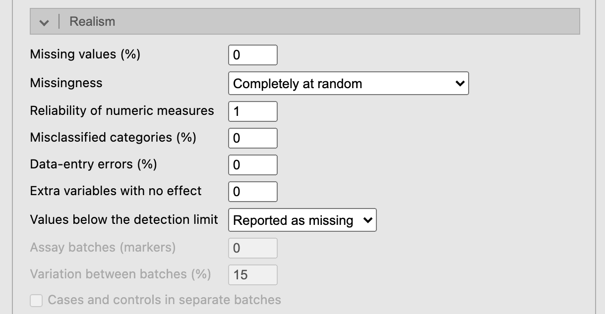
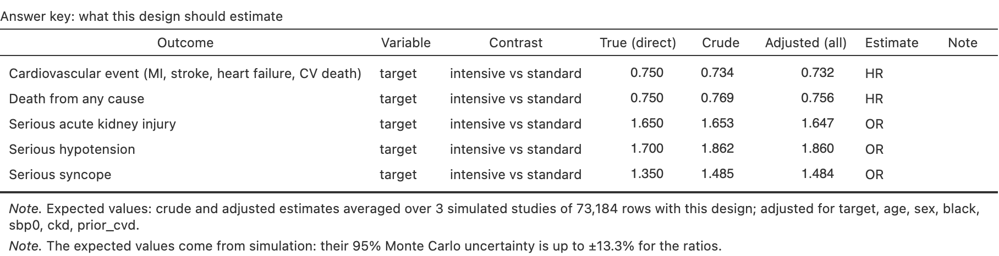
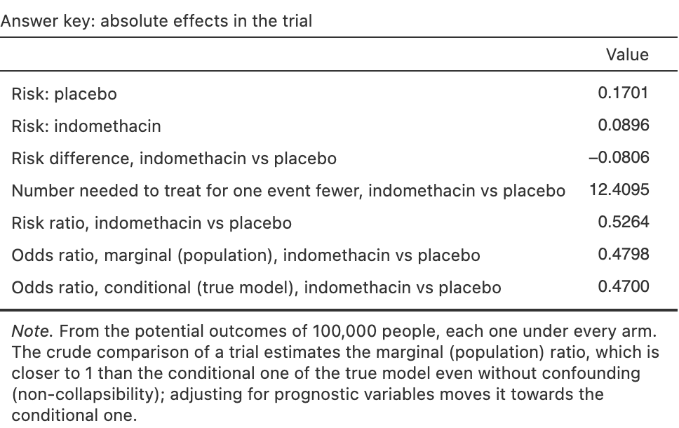
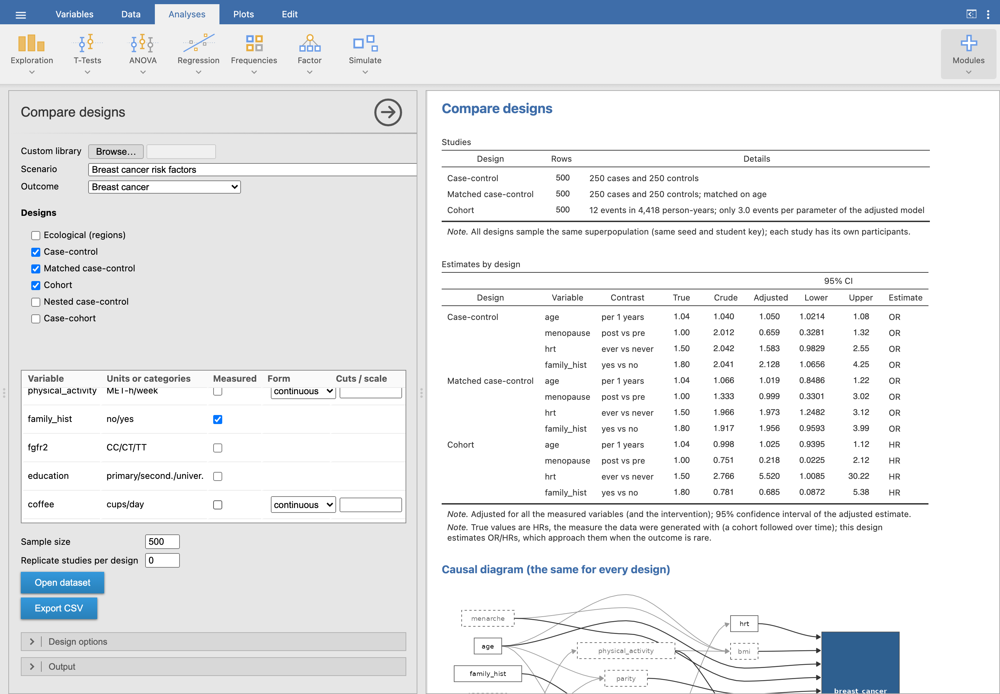
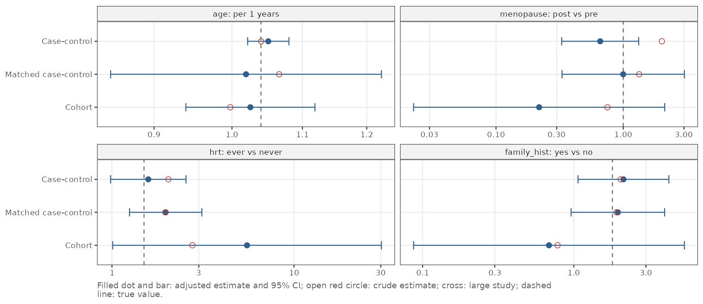
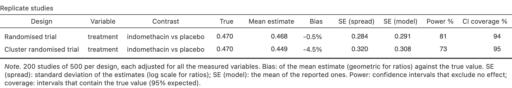

*Simulate ▸ Simulated study* builds one study and opens its data.

## Scenario, outcome and design

{.screenshot width=70%}

- **Scenarios for design** narrows the pickers to the scenarios (and outcomes)
  that fit one design, e.g. every scenario that can be run as a case-cohort study.
- **Scenario** and **Outcome** come from the library (built-in, or a custom one
  read with *Browse…*), grouped by clinical domain.
- **Design** lists only the designs that fit the outcome: an event in a population
  can be studied with a cohort or a case-control study (unmatched or matched), a
  patient outcome with a prognosis cohort, a treatment effect with a randomised
  trial or, for continuous outcomes, a 2×2 crossover.
- **Variables**: every variable is *measured* at start; untick one to leave it
  out of the dataset. It still acts on the outcome, which is how you teach
  residual confounding. The second column shows units or categories; the
  **Exposure** column marks the variable(s) the biases act on (below).
- **Form** groups a numeric variable: median split, tertiles, quartiles, quintiles
  (cut points from the sample, as a study would compute them) or **cuts** typed
  as values (`18.5, 25, 30`; with a decimal comma `18,5; 25`) or percentiles
  (`10%, 90%`). Labels read `Q2: 120–131` or `G1: ≤25`. **log2** and **log10**
  transform it instead (of x + 1 when there are zeros); the answer key then
  gives the effect per doubling or per 10-fold increase. **scale** divides it by
  the number typed in *Cuts / scale* (e.g. `10` for alcohol in units of 10 g/day,
  or `1` to undo the scenario's default unit); the answer key labels the
  contrast *per 10 g/day* and re-expresses the true effect in that unit.
- **Sample size**: people in the study (cases plus controls in a case-control
  study).

### Design options, realism and output

{.screenshot width=70%}

- *Design options*: controls per case; follow-up, loss to follow-up and
  recruitment period for cohorts and trials; subcohort, clusters and ICC,
  interaction, interim looks, visits and dropout, regions; period and carryover
  for a crossover; entry threshold for a before-after study; bias, slope and
  errors of two methods. An **empty box keeps the scenario's value** (many
  scenarios set their own: 4 controls per case, 3 visits); the *Study* summary
  lists the values used. *Repeated measures* gives crossover and longitudinal
  trials one row per measurement (*long*, for mixed models) or one per person
  (*wide*, for a paired t-test or repeated-measures ANOVA).
- *Biases* builds a bias into the study, and into the answer key's large study,
  so the key shows what the biased design estimates: **recall bias** and
  **controls selected by exposure** (case-control), a **collider** `admitted`
  caused by the outcome and the exposure, **non-adherence** to treatment related
  to prognosis (a column `received`; the key adds as-treated and per-protocol
  rows), **informative loss to follow-up**, a treatment started during
  follow-up with no effect (**immortal time**: `treated`, `treatment_start`), and
  in diagnostic studies **spectrum** (only the most severe diseased) and
  **partial verification** (only some test-negatives get the reference
  standard). Recall, selection and the collider need a ticked *Exposure*. See
  [Teaching](teaching.qmd#biases-on-purpose).

  {.screenshot width=60%}
- *Realism*:
  - **missing values** in the measured variables: completely at random,
    depending on the outcome, or depending on the missing value itself (MNAR);
  - **measurement error**: the reliability of numeric measures and a share of
    misclassified categories, non-differential. The answer key uses the same
    error, so it shows how much the estimates are diluted and how much
    confounding remains;
  - **data-entry errors** (decimal slips, swapped digits, 999 codes) to find and
    clean, and **extra variables** with no effect (`extra_01`, …) for multiple
    testing and variable selection;
  - **laboratory**: values below a marker's or a biomarker's detection limit
    reported as missing, as LOD/2 or as the LOD; diagnostic markers run in
    **batches**, optionally with cases and controls in separate batches.

  {.screenshot width=60%}

- *Output*: seed and **student key** (any text, e.g. a student ID: each key gives
  a different dataset from the same options; capitals and surrounding spaces
  are ignored), which tables to show, and
  **Answer key report**, which saves the whole key (true model, what the design
  should estimate, markers, diagram, notes) as one HTML page for the teacher.
  **Export class** takes the *student keys of the class* (separated by commas)
  and saves a zip with one CSV and one codebook per student, a register of keys
  and seeds, and one answer key report. A **teacher code** unlocks a library
  locked with it (see [Teaching](teaching.qmd#assignments-with-student-keys)).

### Several outcomes in one study

Most trials record several outcomes. *Other outcomes of the scenario (same
people)* adds every other outcome of the scenario as columns for the same people
(cross-sectional, cohort, prognosis and trial designs), and the answer key gets a
block per outcome. Outcomes can be linked (correlated beyond their common
causes, e.g. HbA1c and control below 7%), and overall survival can be built
from a first event (an illness-death model: in the colon cancer trial, death
after recurrence).

For example, *Intensive blood-pressure control (SPRINT)* has five outcomes: the
primary cardiovascular event, death from any cause and three harms (acute kidney
injury, hypotension, syncope), to weigh benefits against harms and to see what
testing many outcomes does. The **Outcome** picker lists all five, and the
dataset holds only the one chosen (by default the cardiovascular event). Tick
*Other outcomes of the scenario (same people)* to add the other four as columns
(`time_death`, `death`, `kidney_injury`, `hypotension`, `syncope`); the answer key
then has a block per outcome.

{.screenshot}

### Two more designs

- **Before-after (single group)**: everybody is treated and measured before and
  after, with no control group. The mean change mixes the effect, the natural
  trend and, if only people with high values are enrolled (*Enrol only above
  percentile*), **regression to the mean**.
- **Method comparison**: the outcome measured twice in each person, by methods
  A and B (B with a bias, a proportional bias and its own error), for a
  Bland-Altman analysis; the key gives the mean difference, the limits of
  agreement and the regression slope of B on A, attenuated by A's own error.

The same seed always gives the same study, and the people of the superpopulation
do not depend on the design: the same seed under another design samples the same
people. Showing the key, the diagram or a table does not draw the study again; only
options that change the data do.

## The data

**Open dataset** opens the data in a new jamovi window, with nominal, ordinal and
ID columns typed and each column described; **Export CSV** saves them, and
**Export codebook** saves the data dictionary as another CSV (a CSV keeps no
column descriptions). [Analysing the data in jamovi](analysis.qmd) says which
analysis and module fit each design.

{.screenshot}

Column names and category labels follow jamovi's language (`age` → `edad`/`edat`,
`current` → `fumador`), from dictionaries the teacher can edit
([Library](library.qmd)).

## Results

{.screenshot width=80%}

![Univariate descriptives: mean (SD) and median [IQR], or n (%) per category.](screenshots/s04-descriptives.png){.screenshot width=60%}

The **causal diagram** shows the scenario's structure: measured variables in solid
boxes, unmeasured ones dashed, null variables in italics, grey arrows for paths
among variables, dark arrows for effects on the outcome. It is shown by
default without effect sizes; tick *Effect sizes on the diagram* to colour the
arrows (red raises the outcome, blue lowers it) and give their sizes.

{.screenshot}

## The answer key

*Answer key* adds these parts, for the teacher:

1. **True model**: by contrast, the **direct** (conditional) effects the data
   were generated with, including the null variables, and the **total** effect
   of each variable that also acts through others (mediators), estimated in a
   large simulated population; a variable acting only through others reads *no
   direct effect; acts through …*.

   {.screenshot}

2. **What this design should estimate**: crude and adjusted estimates averaged
   over three large simulated studies with the same design, measured variables,
   grouping, measurement error and biases (one for matched case-control), with
   their Monte Carlo uncertainty in a note. This is what a correct analysis of
   the student's data should approach. *Adjusted (all)* adjusts for every
   measured variable; *Adjusted (DAG)* adjusts each one only for the measured
   variables it does not cause, and approaches its *True (total)*. Where the
   generating measure differs from the design's (hazard ratios generated, odds
   ratios estimated by a case-control study) a note says so.
   Trials with a binary or event outcome add **absolute effects**: risk per
   arm, risk difference, NNT, risk ratio, and the marginal next to the
   conditional odds or hazard ratio. Diagnostic studies add **accuracy at a
   cut-off**: sensitivity, specificity and predictive values, true and in the
   large study.

   {.screenshot width=65%}

   {.screenshot}

3. **Notes**: teaching note of the scenario, calibration of the outcome, latent
   structure and the sources of the parameters.

The *Study* summary warns when there are fewer than 10 events per parameter of a
model adjusted for every measured variable.

## Compare designs

*Simulate ▸ Compare designs* takes one scenario and outcome, the measured
variables and a sample size, and simulates every ticked design from the **same
population** (same seed and student key); designs that do not fit the outcome
are hidden. It shows:

{.screenshot}

- **Studies**: rows, cases and controls, events, clusters or regions of each one;
- **Estimates by design**: crude and adjusted estimates with their 95% CI
  next to the true values, and optionally what each design gives in a large study;
- a **forest plot** of the same estimates, one panel per contrast;
- the **causal diagram**, once, because it is the same for
  every design: what changes between designs is how the population is sampled,
  not how it works.

{.screenshot}

**Replicate studies per design** (next to the sample size) draws that many
studies of each design and reports each estimate's mean, bias, spread (empirical
standard error) next to the model's, power and the coverage of its confidence
intervals, with a plot of their sampling distribution.

{.screenshot}

*Open dataset* stacks all the studies in one dataset with a `design` column, to
analyse them with jamovi's filters. Typical exercises: a case-control vs a cohort
study of a rare cancer (same estimates, very different precision for the same
number of people), a parallel vs a crossover trial, an ecological vs an
individual-level analysis.
