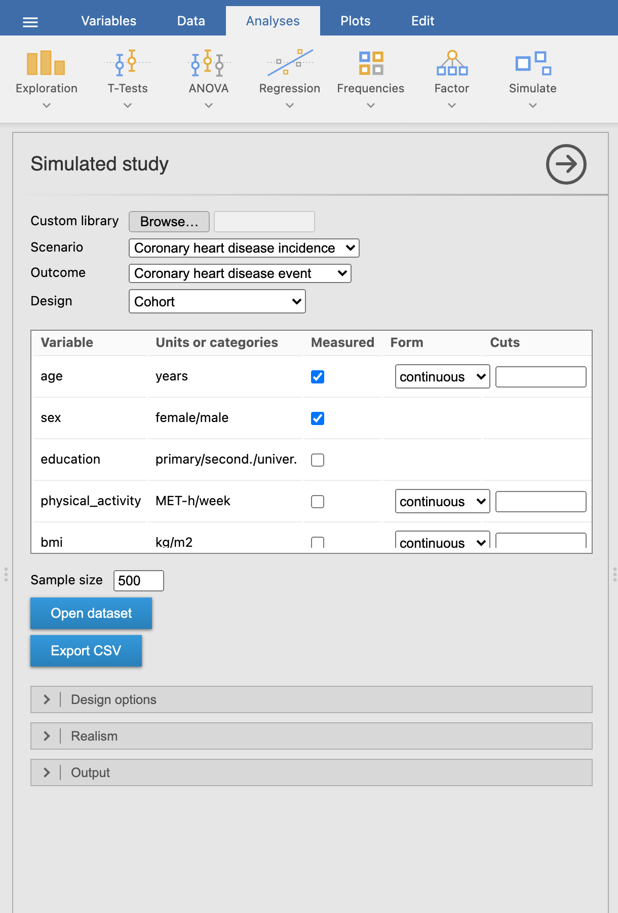
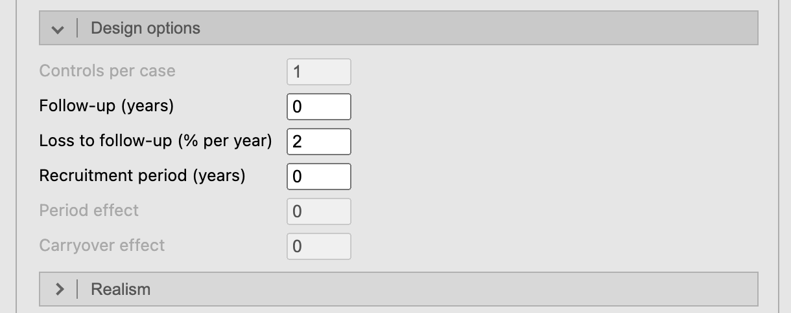
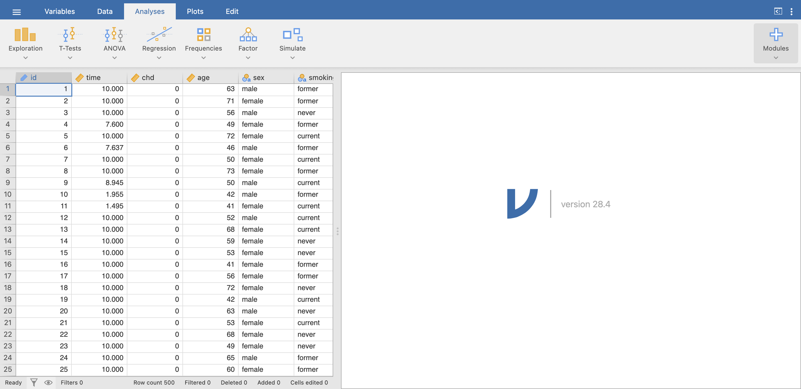
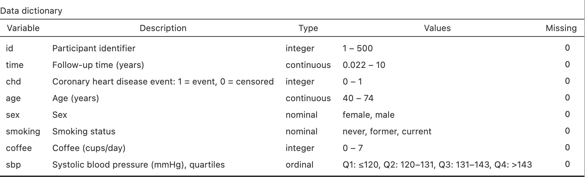
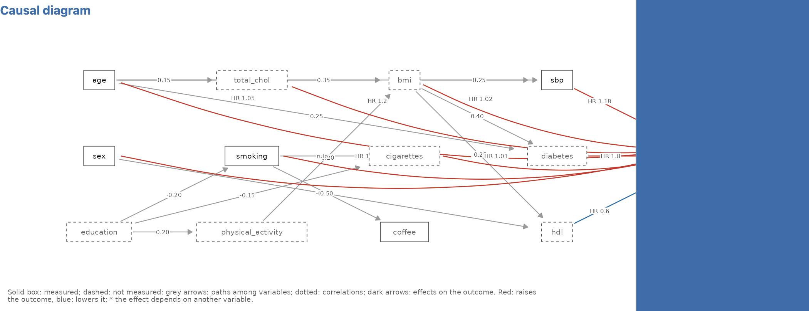
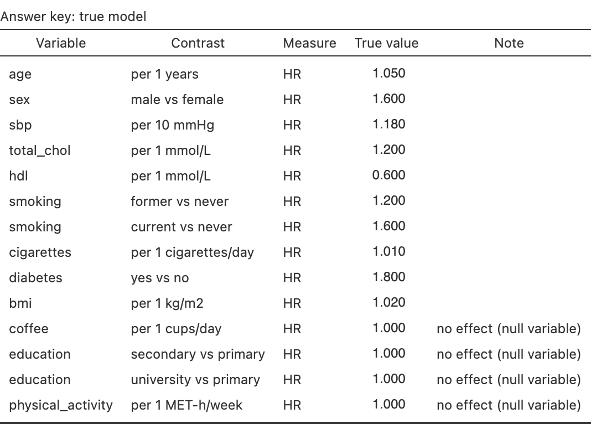
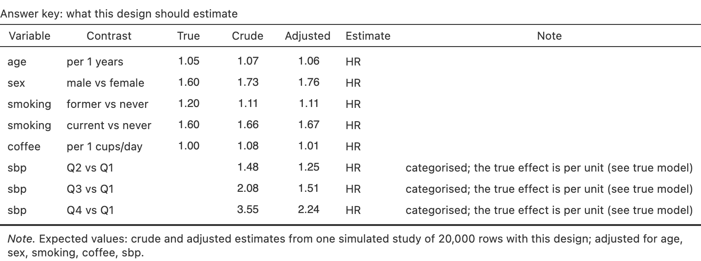

*Simulate ▸ Simulated study* builds one study and opens its data.

## Scenario, outcome and design

{.screenshot width=70%}

- **Scenario** and **Outcome** come from the library (built-in, or a custom one
  read with *Browse…*).
- **Design** lists only the designs that fit the outcome: an event in a population
  can be studied with a cohort or a case-control study (unmatched or matched), a
  patient outcome with a prognosis cohort, a treatment effect with a randomised
  trial or, for continuous outcomes, a 2×2 crossover.
- **Variables**: tick the variables to *measure*. None is ticked at start. The
  others are not in the dataset but still act on the outcome, which is how you
  teach residual confounding. The second column shows units or categories.
- **Form** groups a numeric variable: median split, tertiles, quartiles, quintiles
  (cut points from the sample, as a study would compute them) or **cuts** typed
  as values (`18.5, 25, 30`; with a decimal comma `18,5; 25`) or percentiles
  (`10%, 90%`). Labels read `Q2: 120–131` or `G1: ≤25`.
- **Sample size**: people in the study (cases plus controls in a case-control
  study).

### Design options, realism and output

{.screenshot width=70%}

- *Design options*: controls per case; follow-up, loss to follow-up and
  recruitment period for cohorts and trials; period and carryover effects for a
  crossover. A 0 keeps the scenario's default.
- *Realism*: a percentage of missing values in the measured variables, completely
  at random or depending on the outcome.
- *Output*: seed and **student key** (any text, e.g. a student ID: each key gives
  a different dataset from the same options), and which tables to show.

The same seed always gives the same study, and the people of the superpopulation
do not depend on the design: the same seed under another design samples the same
people. Showing the key, the diagram or a table does not draw the study again; only
options that change the data do.

## The data

**Open dataset** opens the data in a new jamovi window, with nominal, ordinal and
ID columns typed and each column described; **Export CSV** saves them.

{.screenshot}

Column names and category labels follow jamovi's language (`age` → `edad`/`edat`,
`current` → `fumador`), from dictionaries the teacher can edit
([Library](library.qmd)).

## Results

{.screenshot width=80%}

![Univariate descriptives: mean (SD) and median [IQR], or n (%) per category.](screenshots/s04-descriptives.png){.screenshot width=60%}

The **causal diagram** shows the scenario's structure: measured variables in solid
boxes, unmeasured ones dashed, null variables in italics, grey arrows for paths
among variables, dark arrows for effects on the outcome. *Effect sizes on the
diagram* adds the values (red raises the outcome, blue lowers it).

{.screenshot}

## The answer key

*Answer key* adds three parts, for the teacher:

1. **True model**: the conditional effects the data were generated with, by
   contrast, including the null variables (no effect).

   {.screenshot width=75%}

2. **What this design should estimate**: crude and adjusted estimates from one
   large simulated study with the same design, measured variables and grouping.
   This is what a correct analysis of the student's data should approach. Where
   the generating measure differs from the design's (hazard ratios generated, odds
   ratios estimated by a case-control study) a note says so.

   {.screenshot}

3. **Notes**: teaching note of the scenario, calibration of the outcome, latent
   structure and the sources of the parameters.
